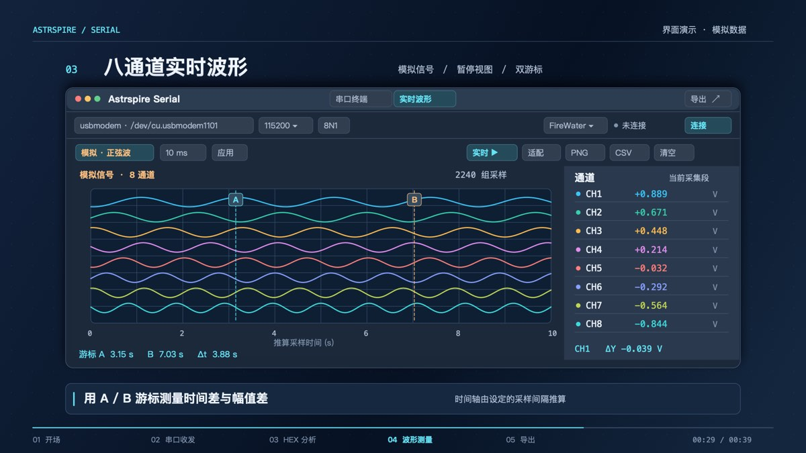

# 我的 Mac 小工具

从这台 Mac 上已安装的应用中整理出一些实用小工具，记录用途、官方入口和界面预览。第三方工具的图片来自各项目公开的官方展示，界面可能随版本变化。

## 设备与桌面

### [AirBattery](https://github.com/lihaoyun6/AirBattery)

在菜单栏、Dock 或小组件中查看附近设备的电量。

[下载与使用说明](https://github.com/lihaoyun6/AirBattery#installation-and-usage)

### [Boring Notch](https://github.com/TheBoredTeam/boring.notch)

让 MacBook 刘海区域提供音乐控制、文件暂存和日历等功能。

[下载与安装](https://github.com/TheBoredTeam/boring.notch#installation)

## 系统与浏览

### [System Data Unpacked](https://github.com/Jarvis322/macos-sysdata)

查看 macOS“系统数据”的空间构成，并逐项检查可清理内容。

[项目主页与下载](https://github.com/Jarvis322/macos-sysdata)

### [AdGuard Mini](https://github.com/AdguardTeam/AdGuardMiniForMac)

为 Safari 过滤广告和追踪内容，让网页更清爽。

[项目主页与下载](https://github.com/AdguardTeam/AdGuardMiniForMac)

## 我们一起制作的小工具

### [GoalTracker 赛事看板](GoalTracker/README.md)

用桌面倒计时卡片和赛程列表管理比赛与学习目标。

[查看源码与使用说明](GoalTracker/README.md) · [下载本机版](downloads/GoalTracker-macOS.zip)

本机版需要 macOS 27 或更高版本；桌面卡片是可拖动窗口，原生 WidgetKit 版本需要按说明配置签名后构建。

### [Astrspire Serial 串口工具](Astrspire-Serial/README.md)

面向 STM32 调试的 macOS 串口终端与实时波形工具。

[查看源码与使用说明](Astrspire-Serial/README.md) · [下载 Apple Silicon 版](downloads/Astrspire-Serial-1.0-arm64.zip)

应用最低支持 macOS 14；展示图使用模拟数据，实物串口设备还需自行验收。

两个下载包均为本机构建，未经 Apple 公证。

---

第三方软件和图片归各自作者所有；自制工具不包含本机赛程或串口采集数据。
